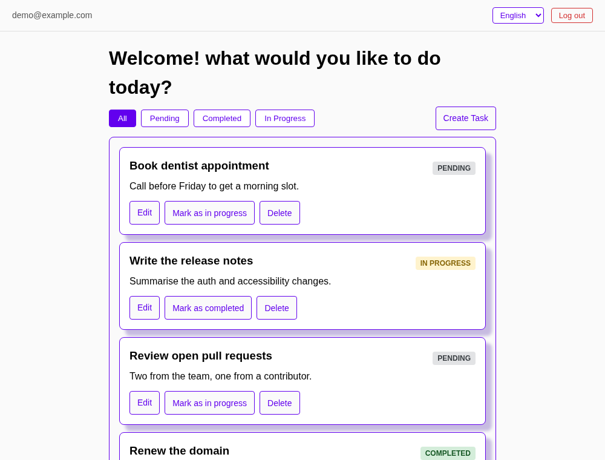
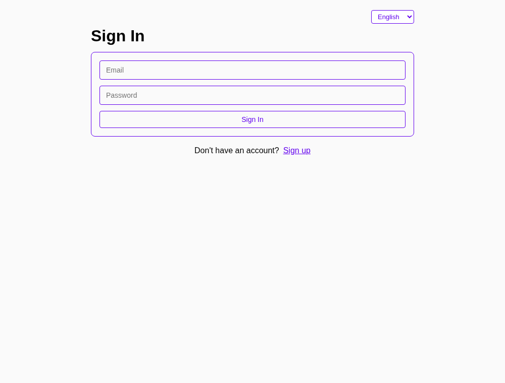
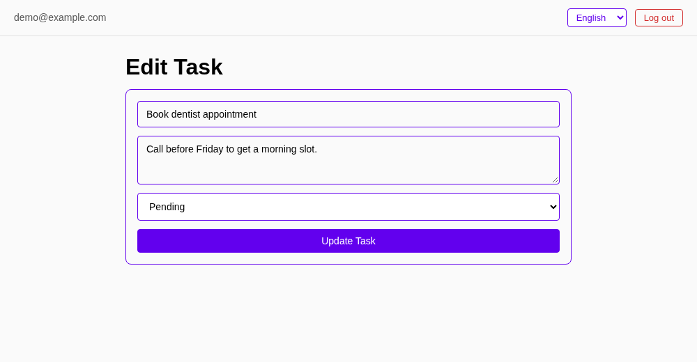
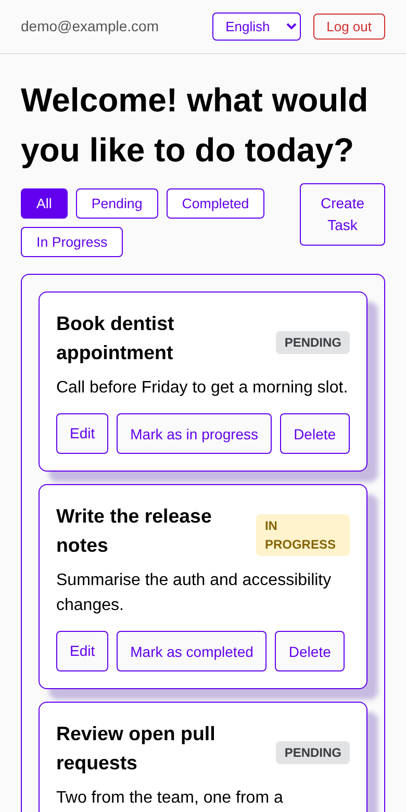
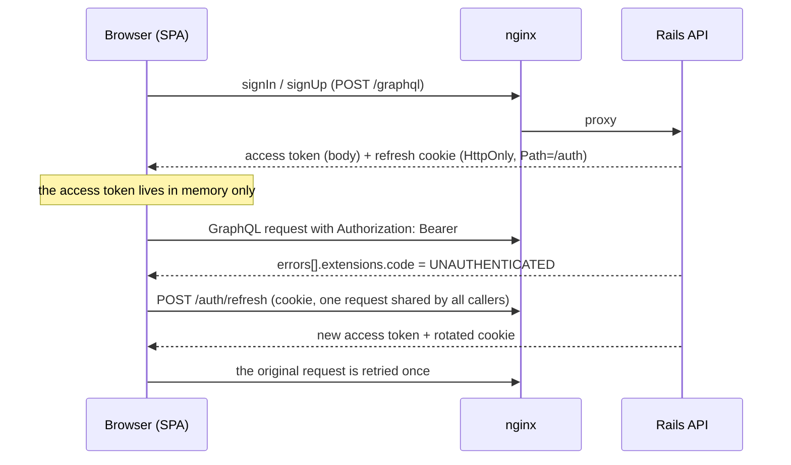

# Task Management Frontend

A personal task manager: create, edit, filter, page through and delete tasks, with JWT authentication, English, Spanish and Japanese, and an accessible, keyboard-friendly interface. It is a React single-page app that talks to a Rails GraphQL API.

This is the **frontend** repository. The backend lives at [task-management-api](https://github.com/paulorivera27/task-management-api); the two are developed together and share the contract described in [Working with the API](#working-with-the-api).

<p>
  
</p>

<details>
<summary>More screenshots</summary>

<p>
  
  
</p>
<p>
  
</p>

</details>

---

## Features

- Create, edit, delete and change the status of tasks; filter by status; offset pagination
- Sign up, sign in and sign out, with a session that survives reloads and silently renews itself
- English, Spanish and Japanese, chosen from the browser language and remembered
- Page and filter live in the URL (`/?status=COMPLETED&page=2`), so reloads and shared links keep their place
- Labelled forms, visible keyboard focus, real links for navigation, landmarks and live regions for errors
- Failed saves are reported on the page instead of being treated as successes

## Tech Stack

| Layer          | Technology                                                    |
| -------------- | ------------------------------------------------------------- |
| Framework      | React 19                                                      |
| Language       | TypeScript 5.9 (strict)                                       |
| Build Tool     | Vite 7                                                        |
| GraphQL Client | Apollo Client 4                                               |
| Routing        | React Router 7                                                |
| Styling        | styled-components 6 with CSS custom properties                |
| i18n           | i18next (English, Spanish, Japanese)                          |
| Testing        | Vitest, Testing Library, MSW, axe-core                        |
| Linting        | ESLint 9 with react-hooks and jsx-a11y                        |
| CI/CD          | GitHub Actions (lint, typecheck, tests, audit, build, Docker) |
| Deploy         | Docker (Node build, unprivileged nginx server)                |

---

## Quick Start with Docker Compose

The backend repository's Docker Compose file builds and starts the database, the API and this app together.

**Prerequisites:** Docker and Docker Compose.

**Both repositories must be cloned side by side in the same parent directory:**

```
parent-directory/
├── task-management-api/          # backend repo
└── task-management-frontend/     # this repo
```

```bash
# 1. Clone both repos
git clone https://github.com/paulorivera27/task-management-api.git
git clone https://github.com/paulorivera27/task-management-frontend.git

# 2. Configure the backend (it signs tokens with SECRET_KEY_BASE)
cd task-management-api
cp .env.example .env
echo "SECRET_KEY_BASE=$(openssl rand -hex 64)" >> .env

# 3. Build and start all services
docker compose up --build
```

- **Frontend:** http://localhost:3000
- **API endpoint:** http://localhost:4000/graphql

---

## Local Development

Start the API first (see the [backend README](https://github.com/paulorivera27/task-management-api#local-development-setup-without-docker)); it listens on `http://localhost:4000`.

**Prerequisites:** Node.js 22 (see `.nvmrc`) and npm.

```bash
git clone https://github.com/paulorivera27/task-management-frontend.git
cd task-management-frontend
npm install
npm run dev
```

The app is served at http://localhost:3000. The dev server proxies `/graphql` and `/auth` to the API, so development is same-origin, exactly like production behind nginx: the refresh cookie works without any CORS setup.

### Environment variables

Nothing is required. Copy `.env.example` to `.env` only to change a default.

| Variable       | Where       | Default                 | Description                                                                                                                                                |
| -------------- | ----------- | ----------------------- | ---------------------------------------------------------------------------------------------------------------------------------------------------------- |
| `DEV_API_URL`  | dev server  | `http://localhost:4000` | Origin the dev server proxies to. Set it in your shell.                                                                                                    |
| `VITE_API_URL` | build / dev | `/graphql`              | Call an API on another origin instead of the proxy. It then needs CORS with credentials, and the production CSP (`connect-src 'self'`) must be relaxed.    |
| `BACKEND_URL`  | Docker run  | `http://backend:80`     | Origin nginx proxies `/graphql` and `/auth` to. Origin only, no path. Resolved per request, so the container starts without the API.                       |

### Scripts

```bash
npm run dev          # dev server on port 3000, proxying the API
npm run lint         # ESLint (react-hooks, jsx-a11y)
npm run typecheck    # tsc -b: type-checks the app and the Vite config
npm test             # Vitest, once
npm run test:watch   # Vitest in watch mode
npm run build        # type-check, then production build into dist/
npm run preview      # serve the production build
```

---

## Project Structure

```
src/
├── App.tsx                  # providers, lazy-loaded routes
├── lib/
│   ├── apollo.ts            # client, in-memory token, refresh and error link
│   ├── errors.ts            # error classification and API message translation
│   └── cache.ts             # task cache invalidation
├── context/                 # AuthProvider and useAuth
├── hooks/                   # useMutationFeedback
├── pages/                   # list, create, edit, sign-in, 404
├── components/              # task card, list, form, filter, pagination, navbar, ...
│   └── styles/              # styled-components
├── graphql/                 # queries and mutations
├── i18n/                    # i18next setup and en / es / ja locales
├── utils/                   # constants and pagination helpers
├── theme.ts                 # status colours (other colours: CSS custom properties in index.css)
├── types/
└── test/                    # MSW server, request mocks, render helpers, axe helper
nginx/                       # nginx config template, security headers, proxy headers
scripts/docker-smoke.sh      # runs the image on its own and checks it
```

---

## Authentication



1. The API returns a short-lived JWT (15 minutes) in the response body and sets a single-use refresh token as an `HttpOnly`, `SameSite=Strict` cookie scoped to `Path=/auth`.
2. The access token is held in a module variable, never in `localStorage`. Apollo's auth link attaches it as `Authorization: Bearer <token>`.
3. When an operation fails with `extensions.code = "UNAUTHENTICATED"` (the legacy message `Authentication required` is still recognised), the error link refreshes the token and retries the operation once. Concurrent refreshes share one request, because refresh tokens are single-use.
4. On page load the app refreshes silently to restore the session. A refresh whose response is lost in transit is retried once; the API honours the old cookie for a short grace window.
5. Only a `401` from `/auth/refresh` ends the session. `429`, `5xx` and network failures keep it: an operation that hit one shows a translated message (rate limit, server or network). If the refresh fails at startup there is no session to keep, so the sign-in page is shown without a message.
6. When the session is gone the user and the Apollo store are cleared and the user is sent to the sign-in page, which returns to where they were after signing in.
7. Logging out waits for the server to revoke the refresh token. If that fails the user stays signed in and sees an error, so the cookie cannot silently restore the session.

---

## Working with the API

The two repositories rely on the same contract. The backend documents it under [Authentication](https://github.com/paulorivera27/task-management-api#authentication) and [REST Auth Endpoints](https://github.com/paulorivera27/task-management-api#rest-auth-endpoints); this is what the frontend depends on.

| Contract                                                                                  | Frontend behaviour                                                                          |
| ----------------------------------------------------------------------------------------- | ------------------------------------------------------------------------------------------- |
| Unauthenticated operations fail with `extensions.code = "UNAUTHENTICATED"`                | Triggers the refresh and retry                                                              |
| `POST /auth/refresh` answers `401` for an invalid or revoked refresh token                | Ends the session                                                                            |
| `POST /auth/refresh` answers `429` (120/min) or `5xx`                                      | Keeps the session, shows a translated error                                                 |
| Refresh tokens are single-use and a replay is tolerated for about 10 seconds              | One shared refresh request; one retry after a lost response                                 |
| The refresh cookie is `HttpOnly`, `SameSite=Strict`, `Path=/auth`                         | Sign-in and sign-up receive it on the `/graphql` response, so `credentials: "include"` stays |
| `/graphql` accepts `application/json` only and is limited to 60 requests per minute per IP | Apollo sends JSON; a `429` shows "Too many requests"                                       |
| Mutations report validation failures in the payload `errors` with HTTP 200                | Shown on the page, never treated as success; known messages are translated                  |
| Passwords need at least 8 characters                                                      | Enforced client-side as well                                                                |
| `tasks` accepts `limit` 1 to 100 and `offset` 0 or more                                   | The list uses pages of 10                                                                   |

If you change one side of this table, change the other, and update both READMEs.

---

## Testing

```bash
npm test
```

- **`lib/apollo`**: refresh deduplication, `401` versus `429`/`5xx`/network/malformed responses, retry with the refreshed token, no retry loops, one retry after a lost response, session-lost notification
- **Auth**: provider bootstrap (including React StrictMode's double mount), logout success and failure, protected routes, the sign-in page (redirect back, open-redirect guard, API and transport errors)
- **Tasks**: create, edit, delete and status change, including payload errors, rate limits and network failures; list state in the URL, page clamping, keeping previous results while loading, cache invalidation
- **Accessibility**: every page is scanned with axe-core, plus explicit assertions for labels, links, landmarks, `aria-pressed` and `aria-current`
- **i18n**: en/es/ja key parity and identical interpolation placeholders, regional language tags, `<html lang>`, translated API messages
- **App**: the lazy-loaded routes through `<App />`

The tests use [MSW](https://mswjs.io) to stand in for the API; a request that is not mocked fails the test. jsdom has no layout, so colour contrast is not part of the axe scans there.

---

## Docker

```bash
docker build -t task-management-frontend .
docker run --rm -p 3000:3000 -e BACKEND_URL=http://api.internal:4000 task-management-frontend
scripts/docker-smoke.sh task-management-frontend
```

The image builds the app with Node 22 and serves it with [`nginx-unprivileged`](https://hub.docker.com/r/nginxinc/nginx-unprivileged) (pinned tag, non-root user, `HEALTHCHECK` on `/healthz`).

- `/graphql` and `/auth/` are proxied to `BACKEND_URL`. The address is resolved per request, so the container starts before the API is reachable and answers `502` while it is down.
- Every response carries a `Content-Security-Policy` (`default-src 'self'`; inline styles are allowed for styled-components), `X-Content-Type-Options`, `X-Frame-Options`, `Referrer-Policy` and `Permissions-Policy`; the server version is hidden.
- Text assets are gzip-compressed. Hashed files under `/assets/` are cached for a year and a missing one is a `404`, never `index.html`. `index.html` and client-side routes are revalidated.
- The security headers are the only copy: the same headers from the API are dropped on the proxied routes. `X-Forwarded-Proto` from the client is passed on as is, so run nginx behind a proxy that overwrites it (or accept that a client can make its own session cookie `Secure` over plain HTTP).
- `scripts/docker-smoke.sh` runs the image on its own and checks all of the above except the proxied headers, which need an API behind it. CI runs it after the build.

The API rate-limits by client IP and nginx forwards `X-Forwarded-For`. If you set `TRUSTED_PROXIES` on the API, include this container's network, otherwise every user shares the proxy's rate-limit bucket: see the [backend README](https://github.com/paulorivera27/task-management-api#environment-variables).

---

## CI

GitHub Actions runs on every push and pull request to `master`:

| Job                  | What it does                                                             |
| -------------------- | ------------------------------------------------------------------------ |
| `lint-and-typecheck` | ESLint, type check, tests, and `npm audit` for production dependencies   |
| `build`              | Production build (`tsc -b && vite build`)                                |
| `docker`             | Builds the image and runs `scripts/docker-smoke.sh` against it           |

Dependabot keeps npm, GitHub Actions and Docker dependencies current.

---

## Design Notes

- **In-memory access token.** It is not readable from storage, so a stolen `localStorage` is not a stolen session. Script running in the page could still use it while the page lives, which is what the strict CSP and the absence of `dangerouslySetInnerHTML` are there to prevent. The refresh token never reaches JavaScript.
- **Apollo as the only data layer.** There is no extra state library. After a write the cached task lists are evicted, so every page and filter is fresh and mounted queries refetch themselves. `Query.task` reads from the cache, so Edit opens instantly from a list item.
- **List state in the URL.** Page and filter are search parameters, validated on read; a page past the end moves to the last page.
- **Errors are first-class.** Payload errors, rate limits, network failures and expired sessions each have a translated message and a defined state, and the tests cover them.
- **Styling.** Colours are CSS custom properties in `src/index.css`; components use styled-components. Routes are lazy-loaded and the vendor libraries have their own chunks.

## Known Limitations

- GraphQL documents and TypeScript types are maintained by hand; there is no code generation from the API schema yet.
- Signing out in one tab does not sign out the other tabs until their access token expires (up to 15 minutes).
- Colour contrast and keyboard focus were checked in a real browser with axe-core but are not automated in CI.

---

## License

MIT, see [LICENSE](LICENSE).
